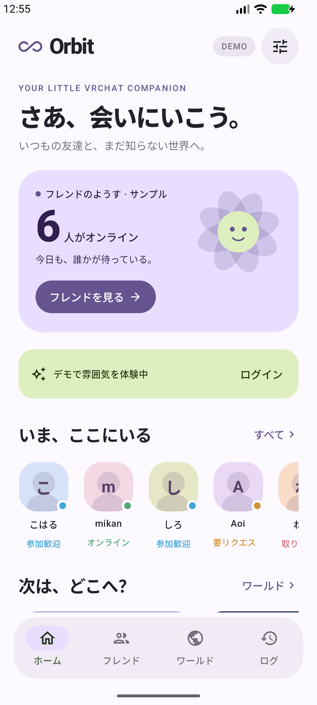
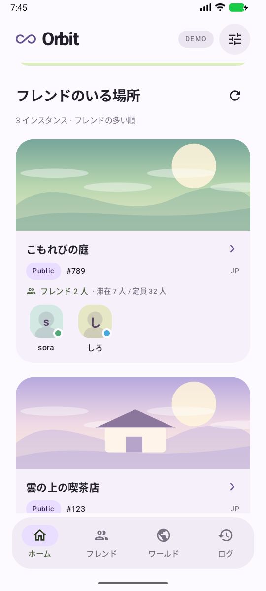

# Orbit — VRChat Tools for Android

Orbitは、VRChatのフレンドがどこにいるかを確認したり、気になるワールドを探したりできる非公式Androidアプリです。KotlinとJetpack Composeで開発しています。

 

## 入手方法

Android 7.0以降に対応しています。現在はソースからAPKをビルドして試せます。[ビルド手順](#ビルド)

## 主な機能

- フレンドのオンライン状況と現在地を確認し、同じインスタンスにいるフレンドをまとめて表示
- ワールドを検索し、気になるワールドを端末にブックマーク
- アプリ内で通知を確認し、招待や招待リクエストを送信
- 自分のステータスを変更し、よく使う設定をプリセットに保存
- フレンドのオンライン状態や現在地の変化をアクティビティで確認

## 使い始める

初回起動時はデモモードで、ログインせずに画面や操作を試せます。自分のフレンドや通知を見るには、ホームまたは設定からVRChatアカウントでログインしてください。

フレンドの状態や通知はアプリを表示している間に更新されます。通知はアプリ内で確認できます。

## ログインとデータの扱い

VRChat APIにHTTPSで直接接続します。パスワードと2段階認証コードは永続保存しません。ログイン状態を維持する認証Cookieは、Android Keystoreの鍵で暗号化して端末に保存し、ログアウト時に削除します。

お気に入り、ワールドのブックマーク、アクティビティ履歴はアカウントごとに端末内に保存され、ログアウト後も残ります。

## ビルド

Android StudioのJBR（JDK 17以上）とAndroid SDK 37を用意し、リポジトリのルートで実行します。

```sh
./gradlew :app:assembleDebug
```

APKは `app/build/outputs/apk/debug/app-debug.apk` に生成されます。

コミュニティが文書化したVRChat APIを使用しています。実アカウントでのログインとAPI通信は未検証です。[VRChat API仕様](https://github.com/vrchatapi/specification)

## ライセンス

OrbitのソースコードはMITライセンスで公開します。[ライセンス全文](LICENSE)
